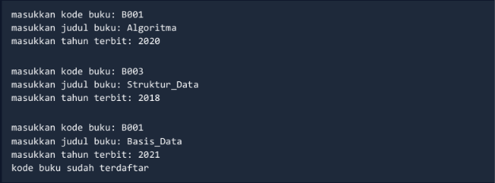
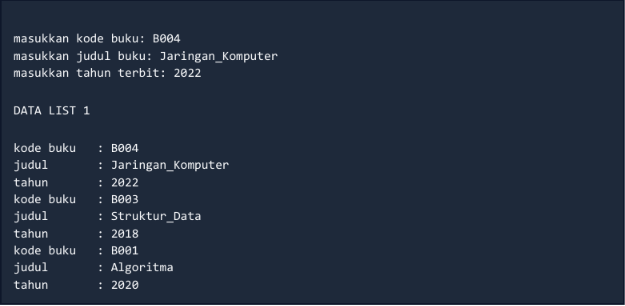
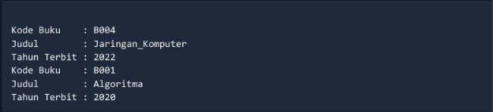
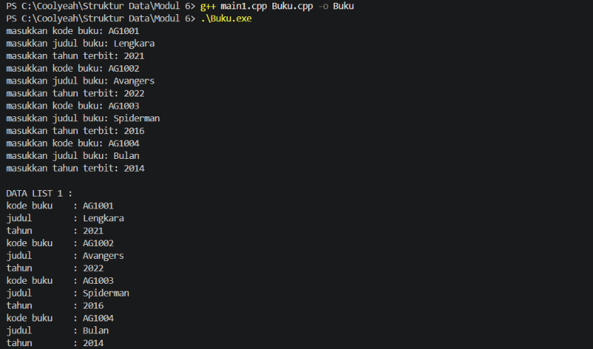
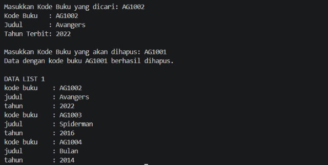

# <h1 align="center">Laporan Praktikum Modul 6 - DOUBLY LINKED LIST
<p align="center">Assyifa Zahra - 109082500196 

## **Dasar Teori**

Doubly Linked List adalah struktur data linier yang terdiri dari sekumpulan simpul (node) yang saling terhubung di mana setiap simpulnya memiliki tiga bagian utama, yaitu medan informasi (info), pointer yang menunjuk ke elemen berikutnya (next), dan pointer yang menunjuk ke elemen sebelumnya (prev). Dalam implementasi pengelolaan data buku, tipe data bentukan infotype mencakup atribut seperti kode buku, judul, dan tahun terbit. Struktur ini dikontrol oleh elemen penanda utama berupa pointer First dan Last yang memungkinkan penelusuran data dari dua arah secara bolak-balik. Berbagai operasi dasar yang diterapkan pada struktur ini meliputi pembuatan list (CreateList), alokasi serta dealokasi memori, penambahan elemen di akhir list (insertLast) yang disertai validasi pengecekan duplikasi kode buku, pencetakan informasi list (printInfo), pencarian elemen berdasarkan kriteria tertentu (findElm), hingga prosedur penghapusan elemen seperti deleteFirst, deleteLast, dan deleteAfter untuk memastikan integritas pointer tetap terjaga dengan baik.

# Guided
### Doublylist.cpp
```
#include "Doublylist.h"

// Latihan 1
void CreateList(List &L) {
    L.First = Nil;
    L.Last = Nil;
}

address alokasi(infotype x) {
    address P = new elmlist;
    P->info = x;
    P->next = Nil;
    P->prev = Nil; 
    return P;
}

void dealokasi(address &P) {
    delete P;
}

void printInfo(List L) {
    address P = L.Last;
    if (P == Nil) {
        std::cout << "List kosong." << std::endl;
        return;
    }
    while (P != Nil) {
        std::cout << "no polisi : " << P->info.nopol << std::endl;   
        std::cout << "warna     : " << P->info.warna << std::endl;   
        std::cout << "tahun     : " << P->info.thnBuat << std::endl; 
        P = P->prev;
    }
}

void insertLast(List &L, address P) {
    if (L.First == Nil) { 
        L.First = P;
        L.Last = P;
    } else {
        P->prev = L.Last;         
        (L.Last)->next = P;     
        L.Last = P;               
    }
}

// Latihan 2
address findElm(List L, std::string nopol) {
    address P = L.First;
    while (P != Nil) {
        if (P->info.nopol == nopol) {
            return P;
        }
        P = P->next;
    }
    return Nil;
}

// Latihan 3
void deleteFirst(List &L, address &P) {
    if (L.First == Nil) return;

    P = L.First; 
    if (L.First == L.Last) { 
        L.First = Nil;
        L.Last = Nil;
    } else {
        L.First = P->next;     
        (L.First)->prev = Nil; 
        P->next = Nil;         
    }
}

void deleteLast(List &L, address &P) {
    if (L.First == Nil) return;

    P = L.Last; 
    if (L.First == L.Last) { 
        L.First = Nil;
        L.Last = Nil;
    } else {
        L.Last = P->prev;      
        (L.Last)->next = Nil; 
        P->prev = Nil;         
    }
}

void deleteAfter(List &L, address Prec, address &P) {
    if (Prec == Nil || Prec->next == Nil) return;

    P = Prec->next;
    if (P == L.Last) {
        deleteLast(L, P);
    } else {
        Prec->next = P->next;     
        (P->next)->prev = Prec; 
        P->next = Nil;            
        P->prev = Nil;           
    }
}

void deleteElm(List &L, std::string nopol, bool &status) {
    address P = findElm(L, nopol);
    status = false;

    if (P != Nil) {
        if (P == L.First) {
            deleteFirst(L, P);
        } else if (P == L.Last) {
            deleteLast(L, P);
        } else {
            address Prec = P->prev;
            deleteAfter(L, Prec, P);
        }
        dealokasi(P); 
        status = true;
    }
}
```

Program ini merupakan implementasi struktur data *Doubly Linked List* dalam bahasa C++ yang dirancang untuk mengelola data kendaraan berdasarkan nomor polisi, warna, dan tahun pembuatannya. Secara keseluruhan, program ini terbagi menjadi beberapa modul fungsional yang meliputi inisialisasi list, alokasi serta dealokasi memori, penambahan data di posisi akhir (`insertLast`), dan pencarian data spesifik menggunakan fungsi `findElm`. Selain itu, terdapat rangkaian prosedur penghapusan elemen yang lengkap seperti `deleteFirst`, `deleteLast`, dan `deleteAfter`yang diintegrasikan ke dalam fungsi `deleteElm` untuk menghapus data secara aman, memastikan pembaruan pointer `next` dan `prev` berjalan akurat, serta menjaga integritas struktur list agar tetap rapi tanpa terjadi kebocoran memori.

### Doublylist.h
```
#ifndef DOUBLYLIST_H
#define DOUBLYLIST_H

#include <iostream>
#include <string>

#define Nil NULL

// Latihan 1
struct infotype {
    std::string nopol; 
    std::string warna; 
    int thnBuat;      
};
typedef struct elmlist *address;
struct elmlist {
    infotype info;  
    address next;   
    address prev;   
};
struct List {
    address First; 
    address Last;  
};


// Latihan 1
void CreateList(List &L);
address alokasi(infotype x);
void dealokasi(address &P);
void printInfo(List L);
void insertLast(List &L, address P);

// Latihan 2

address findElm(List L, std::string nopol);

// Latihan 3
void deleteFirst(List &L, address &P);
void deleteLast(List &L, address &P);
void deleteAfter(List &L, address Prec, address &P);
void deleteElm(List &L, std::string nopol, bool &status);

#endif
```

File header `Doublylist.h` ini berfungsi sebagai kerangka atau antarmuka utama untuk program *Doubly Linked List* yang mengelola informasi kendaraan berdasarkan nomor polisi (`nopol`), warna, dan tahun pembuatannya (`thnBuat`). Di dalam file ini didefinisikan struktur data dasar seperti tipe bentukan `infotype` untuk menampung data kendaraan, pointer `address` yang merepresentasikan elemen list (`elmlist`), serta struktur `List` yang memiliki penanda pointer `First` dan `Last` untuk memudahkan akses dari kedua arah. Selain itu, file ini memuat deklarasi seluruh prototipe fungsi dan prosedur yang terorganisasi ke dalam modul latihan, mulai dari inisialisasi list, manajemen alokasi dan dealokasi memori, pencarian data spesifik (`findElm`), hingga kumpulan prosedur penghapusan elemen seperti `deleteFirst`, `deleteLast`, `deleteAfter`, dan `deleteElm`.

### main.cpp
```
#include <iostream>
#include "Doublylist.h"
using namespace std;

void inputData(List &L) {
    infotype data;
    address P;

    cout << "masukkan nomor polisi: "; cin >> data.nopol;
    cout << "masukkan warna kendaraan: "; cin >> data.warna;
    cout << "masukkan tahun kendaraan: "; cin >> data.thnBuat;
    if (findElm(L, data.nopol) == Nil) {
        P = alokasi(data); 
        insertLast(L, P);  
    } else {
        cout << "nomor polisi sudah terdaftar" << endl; 
    }
}

int main() {
    List L;
    CreateList(L); 
    address P;

    // Latihan 1
    inputData(L); 
    inputData(L); 
    inputData(L); 
    inputData(L); 

    cout << "\nDATA LIST 1" << endl; 
    printInfo(L); 

    // Latihan 2
    string nopolCari;
    cout << "\nMasukkan Nomor Polisi yang dicari : "; 
    cin >> nopolCari; 
    
    P = findElm(L, nopolCari); 
    if (P != Nil) {
        cout << "Nomor Polisi : " << P->info.nopol << endl; 
        cout << "Warna        : " << P->info.warna << endl; 
        cout << "Tahun        : " << P->info.thnBuat << endl; 
    } else {
        cout << "Data dengan nomor polisi " << nopolCari << " tidak ditemukan." << endl;
    }

    // Latihan 3
    string nopolHapus;
    bool hapusBerhasil;
    cout << "\nMasukkan Nomor Polisi yang akan dihapus : ";
    cin >> nopolHapus;

    deleteElm(L, nopolHapus, hapusBerhasil); 

    if (hapusBerhasil) {
        cout << "Data dengan nomor polisi " << nopolHapus << " berhasil dihapus." << endl; 
    } else {
        cout << "Data dengan nomor polisi " << nopolHapus << " tidak ditemukan." << endl;
    }
    cout << "\nDATA LIST 1" << endl; 
    printInfo(L); 

    return 0;
}
```

Program utama (`main.cpp`) ini berfungsi untuk menjalankan keseluruhan alur pengolahan data kendaraan menggunakan struktur *Doubly Linked List* yang diawali dengan inisialisasi list melalui pemanggilan `CreateList`. Melalui fungsi `inputData`, program secara berulang menerima masukan dari pengguna berupa nomor polisi, warna, dan tahun pembuatan kendaraan, serta memastikan tidak ada duplikasi data dengan memanfaatkan fungsi pencarian `findElm` sebelum memasukkan elemen baru ke bagian akhir list menggunakan `insertLast`. Setelah data berhasil dimasukkan dan dicetak ke layar, program melanjutkan eksekusinya dengan menguji fitur pencarian elemen berdasarkan nomor polisi tertentu, lalu melakukan proses penghapusan data melalui prosedur `deleteElm` untuk menghapus elemen yang dipilih secara aman sekaligus menampilkan pembaruan kondisi list terakhir.

---

# Unguided
### 1. Pembuatan ADT Dasar dan Insert Data
Buatlah ADT Doubly Linked List sebagai berikut di dalam file "Buku.h": 

```
Type infotype : buku < 
    kodeBuku  : string 
    judul     : string 
    thnTerbit : integer 
> 
 
Type address : pointer to ElmList 
Type ElmList < 
    info : infotype 
    next : address 
    prev : address 
> 
 
Type List < 
    First : address 
    Last  : address 
> 
 
procedure CreateList( input/output L : List ) 
function alokasi( x : infotype ) -> address 
procedure dealokasi( input/output P : address ) 
procedure printInfo( input L : List ) 
procedure insertLast( input/output L : List, input P : address ) 
```
Buatlah implementasi ADT Doubly Linked List pada file “Buku.cpp" dan cobalah hasil implementasi ADT 
tersebut pada file "main.cpp". Pastikan sistem melakukan pengecekan duplikasi kodeBuku sebelum 
memasukkan data baru ke dalam list.

#### Contoh Output :




### 2. Pencarian Elemen (Searching) 
Carilah elemen dengan kode buku B001 dengan membuat fungsi baru: 

```text
fungsi findElm( L : List, x : infotype ) : address
```

#### Contoh Output Pencarian: 


### 3. Penghapusan Elemen (Delete) 
Hapus elemen dengan kode buku B003 dengan membuat prosedur delete berikut:

```text
procedure deleteFirst( input/output L : List, input/output P : address ) 
procedure deleteLast( input/output L : List, input/output P : address ) 
procedure deleteAfter( input Prec : address, input/output P : address ) 
```
#### Contoh Output Penghapusan:




<br>

## Code
### Buku.cpp

```
#include "Buku.h"

void createList(List &L) {
    L.First = NIL;
    L.Last = NIL;
}

address alokasi(infotype x) {
    address P = new ElmList;
    if (P != NIL) {
        P->info = x;
        P->next = NIL;
        P->prev = NIL;
    }
    return P;
}

void dealokasi(address P) {
    delete P;
}

void printInfo(List L) {
    if (L.First == NIL) {
        cout << "List Kosong" << endl;
    } else {
        address P = L.First;
        while (P != NIL) {
            cout << "kode buku    : " << P->info.kodeBuku << endl;
            cout << "judul        : " << P->info.judul << endl;
            cout << "tahun        : " << P->info.thnTerbit << endl;
            P = P->next;
        }
    }
}

void insertLast(List &L, address P) {
    if (L.First == NIL && L.Last == NIL) {
        L.First = P;
        L.Last = P;
    } else {
        P->prev = L.Last;
        L.Last->next = P;
        L.Last = P;
    }
}

// Implementasi Soal 2: Pencarian Elemen
address findElm(List L, string kodeBuku) {
    address P = L.First;
    while (P != NIL) {
        if (P->info.kodeBuku == kodeBuku) {
            return P;
        }
        P = P->next;
    }
    return NIL;
}

// Implementasi Soal 3: Penghapusan Elemen
void deleteFirst(List &L, address &P) {
    if (L.First != NIL) {
        P = L.First;
        if (L.First == L.Last) {
            L.First = NIL;
            L.Last = NIL;
        } else {
            L.First = L.First->next;
            L.First->prev = NIL;
            P->next = NIL;
        }
    }
}

void deleteLast(List &L, address &P) {
    if (L.Last != NIL) {
        P = L.Last;
        if (L.First == L.Last) {
            L.First = NIL;
            L.Last = NIL;
        } else {
            L.Last = L.Last->prev;
            L.Last->next = NIL;
            P->prev = NIL;
        }
    }
}

void deleteAfter(address Prec, address &P) {
    if (Prec != NIL && Prec->next != NIL) {
        P = Prec->next;
        Prec->next = P->next;
        if (P->next != NIL) {
            P->next->prev = Prec;
        }
        P->next = NIL;
        P->prev = NIL;
    }
}

void deleteByKode(List &L, string kodeBuku) {
    address P = findElm(L, kodeBuku);
    if (P == NIL) {
        cout << "Data dengan kode buku " << kodeBuku << " tidak ditemukan." << endl;
        return;
    }

    if (P == L.First) {
        deleteFirst(L, P);
    } else if (P == L.Last) {
        deleteLast(L, P);
    } else {
        address Prec = P->prev;
        deleteAfter(Prec, P);
    }
    dealokasi(P);
    cout << "Data dengan kode buku " << kodeBuku << " berhasil dihapus." << endl;
}
```

File **`Buku.cpp`** adalah file implementasi yang berisi realisasi atau penjabaran kode nyata dari seluruh fungsi dan prosedur yang sebelumnya telah dideklarasikan di dalam file header `Buku.h` untuk mengelola data buku menggunakan *Doubly Linked List*. Di dalam file ini, program mengeksekusi operasi dasar seperti pembuatan list kosong lewat `CreateList`, pemesanan serta pembersihan memori melalui `alokasi` dan `dealokasi`, pencetakan informasi data buku dengan `printInfo`, serta penambahan data baru di akhir list menggunakan `insertLast` yang juga dilengkapi logika pengecekan duplikasi kode buku. Selain itu, file ini memuat logika operasional lanjutan seperti fungsi pencarian elemen berdasarkan kode buku (`findElm`) serta kumpulan prosedur penghapusan elemen yang terstruktur meliputi `deleteFirst`, `deleteLast`, dan `deleteAfter` untuk memastikan keterhubungan pointer `next` dan `prev` tetap valid serta konsisten.

### Buku.h

```text
#ifndef BUKU_H
#ifndef NIL
#define NIL NULL
#endif
#define BUKU_H

#include <iostream>
#include <string>

using namespace std;

// Definisi infotype untuk Buku
struct buku {
    string kodeBuku;
    string judul;
    int thnTerbit;
};

typedef buku infotype;
typedef struct ElmList *address;

// Definisi Elemen List (Doubly Linked List)
struct ElmList {
    infotype info;
    address next;
    address prev;
};

// Definisi List (Memiliki First dan Last)
struct List {
    address First;
    address Last;
};

// Deklarasi Prosedur dan Fungsi ADT
void createList(List &L);
address alokasi(infotype x);
void dealokasi(address P);
void printInfo(List L);
void insertLast(List &L, address P);

// Fungsi Pencarian (Soal 2)
address findElm(List L, string kodeBuku);

// Prosedur Penghapusan (Soal 3)
void deleteFirst(List &L, address &P);
void deleteLast(List &L, address &P);
void deleteAfter(address Prec, address &P);
void deleteByKode(List &L, string kodeBuku);

#endif
```

File **`Buku.h`** adalah file header yang berfungsi sebagai kerangka atau rancangan utama untuk mendefinisikan Struktur Data Abstraksi (*Abstract Data Type* / ADT) **Doubly Linked List** yang khusus digunakan untuk mengelola data buku. Di dalam file ini didefinisikan struktur bentukan `infotype` untuk menampung atribut buku (seperti kode, judul, dan tahun terbit), pointer `address` serta struktur simpul `ElmList` yang memiliki dua arah pointer (`next` dan `prev`), serta struktur `List` yang memuat penanda `First` dan `Last`. Selain itu, file ini memuat seluruh deklarasi prototipe fungsi dan prosedur mulai dari pembuatan list, alokasi memori, pencarian data lewat `findElm`, hingga berbagai metode penghapusan seperti `deleteFirst`, `deleteLast`, dan `deleteAfter`sehingga seluruh bagian kode program dapat saling terhubung dengan terstruktur dan konsisten.

### main.cpp

```text
#include "Buku.h"

int main() {
    List L;
    createList(L);
    infotype dataBuku;
    address P;

    // --- SOAL 1: Insert Data & Pengecekan Duplikasi ---
    int numInput = 4;
    for (int i = 0; i < numInput; i++) {
        cout << "masukkan kode buku: ";
        cin >> dataBuku.kodeBuku;
        cout << "masukkan judul buku: ";
        cin >> dataBuku.judul;
        cout << "masukkan tahun terbit: ";
        cin >> dataBuku.thnTerbit;

        // Pengecekan Duplikasi Kode Buku
        if (findElm(L, dataBuku.kodeBuku) != NIL) {
            cout << "kode buku sudah terdaftar" << endl;
        } else {
            P = alokasi(dataBuku);
            insertLast(L, P);
        }
    }

    cout << "\nDATA LIST 1 :" << endl;
    printInfo(L);
    cout << endl;

    // --- SOAL 2: Pencarian Elemen ---
    string cariKode;
    cout << "Masukkan Kode Buku yang dicari: ";
    cin >> cariKode;
    
    address found = findElm(L, cariKode);
    if (found != NIL) {
        cout << "Kode Buku   : " << found->info.kodeBuku << endl;
        cout << "Judul       : " << found->info.judul << endl;
        cout << "Tahun Terbit: " << found->info.thnTerbit << endl;
    } else {
        cout << "Buku tidak ditemukan." << endl;
    }
    cout << endl;

    // --- SOAL 3: Penghapusan Elemen ---
    string hapusKode;
    cout << "Masukkan Kode Buku yang akan dihapus: ";
    cin >> hapusKode;
    
    deleteByKode(L, hapusKode);
    
    cout << "\nDATA LIST 1" << endl;
    printInfo(L);

    return 0;
}
```
File **`main.cpp`** adalah file utama atau titik eksekusi program yang menjalankan keseluruhan alur sistem **Doubly Linked List** pengolahan data buku. Di dalam file ini, program mengawali proses dengan menginisialisasi list kosong, lalu secara interaktif meminta masukan data buku meliputi kode buku, judul, dan tahun terbit serta melakukan validasi pengecekan duplikasi kode buku agar tidak ada data ganda yang dimasukkan ke dalam list. Setelah menampilkan seluruh daftar data yang tersimpan, program melanjutkan eksekusinya dengan menguji fitur pencarian elemen berdasarkan kode buku tertentu dan memproses penghapusan data buku yang dipilih menggunakan fungsi hapus sebelum akhirnya menampilkan kembali hasil pembaruan kondisi list secara keseluruhan.

### Output Unguided



Gambar tersebut menampilkan hasil keluaran (*output*) dari program *Doubly Linked List* pengolahan data buku saat dijalankan di dalam terminal PowerShell. Pada bagian awal, program berhasil melakukan proses kompilasi kode dan menerima masukan empat data buku secara berurutan meliputi kode buku, judul, dan tahun terbit yang kemudian dicetak secara keseluruhan di bawah label `DATA LIST 1`. Selanjutnya, program mengeksekusi fitur pencarian dengan mencari buku berkode `AG1002`, yang berhasil ditemukan dan menampilkan detail informasi lengkap berupa judul serta tahun terbitnya. Terakhir, program melakukan proses penghapusan data untuk kode buku `AG1001`, dan mencetak kembali daftar list terbaru yang kini hanya menyisakan tiga data buku tersisa secara rapi dan terstruktur.

--- 
<br>

## Kesimpulan
Keseluruhan rangkaian program *Doubly Linked List* pengolahan data buku ini merupakan implementasi struktur data berbasis C++ yang terorganisasi ke dalam tiga komponen utama yaitu file header `Buku.h` sebagai kerangka ADT, file implementasi `Buku.cpp` yang merealisasikan logika fungsi serta prosedur dasar, dan file utama `main.cpp` yang mengeksekusi alur program secara utuh. Berdasarkan hasil keluaran pada terminal, program terbukti mampu berjalan dengan sukses dalam mengelola data secara dinamis, mulai dari memasukkan empat data buku baru dengan validasi pencegahan duplikasi kode, mencetak seluruh isi elemen list, mencari informasi buku tertentu berdasarkan kodenya, hingga menghapus salah satu data buku terdepan secara aman dan memperbarui struktur list yang tersisa dengan rapi.

## Referensi

1. Modul Praktikum Struktur Data, Latihan Praktikum Modul 6: Doubly Linked List, Program Studi Teknik Informatika, Telkom University Purwokerto.