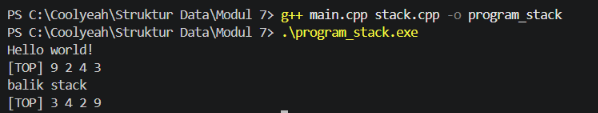

# <h1 align="center">Laporan Praktikum Modul 7 - Implementasi Abstract Data Type (ADT) Stack Menggunakan Representasi Array dan Pointer
<p align="center">Assyifa Zahra - 109082500196 

## **Dasar Teori**
Stack (tumpukan) merupakan salah satu struktur data linier yang mengatur penyimpanan dan pengambilan elemen dengan prinsip Last In, First Out (LIFO), di mana data yang paling terakhir dimasukkan ke dalam tumpukan akan menjadi data yang paling pertama dikeluarkan (Cormen et al., 2022). Prinsip kerja struktur ini serupa dengan tumpukan piring di kafetaria yang hanya dapat diakses melalui satu ujung tunggal yang disebut Top (Cormen et al., 2022; Goodrich et al., 2011). Dalam penerapannya, stack memiliki dua operasi fundamental dengan kompleksitas waktu konstan $O(1)$, yaitu operasi push untuk menyisipkan elemen baru ke posisi teratas dan operasi pop untuk menghapus sekaligus mengambil elemen yang berada di posisi Top (Goodrich et al., 2011). Selain kedua operasi utama tersebut, stack juga dilengkapi operasi pendukung seperti isEmpty untuk memeriksa apakah tumpukan dalam keadaan kosong guna mencegah kesalahan stack underflow saat pengambilan data, serta isFull untuk menghindari stack overflow apabila kapasitas penyimpanan telah mencapai batas maksimum (Cormen et al., 2022).

Secara fisik di dalam memori komputer, Abstract Data Type (ADT) Stack dapat diimplementasikan menggunakan dua pendekatan utama, yakni representasi tabel (array) yang bersifat statis dan representasi pointer (linked list) yang bersifat dinamis (Goodrich et al., 2011; Weiss, 2014). Pada representasi array, stack memanfaatkan deretan indeks berurutan dengan kapasitas maksimum yang telah ditetapkan sejak awal serta sebuah variabel penunjuk indeks Top yang nilainya bertambah satu saat push dan berkurang satu saat pop (Cormen et al., 2022). Meskipun memiliki keterbatasan ukuran dibandingkan linked list, pendekatan berbasis array menawarkan akses memori yang sangat cepat dan efisien karena tidak memerlukan alokasi ruang tambahan untuk menyimpan alamat pointer antar-elemen (Weiss, 2014).

# Guided
### Stack.cpp
```
#include "stack.h"

int isEmpty(Stack S) {
    /* Top = 0 berarti kosong, sesuai komentar di stack.h dikembalikan 0 */
    if (S.Top == 0) {
        return 0;
    } else {
        return 1;
    }
}

void createStack(Stack &S) {
    S.Top = 0;
}

void push(Stack &S, infotype X) {
    if (S.Top < 10) {
        S.Top = S.Top + 1;
        S.info[S.Top - 1] = X;   /* Top 1..10 dipetakan ke indeks array 0..9 */
    } else {
        cout << "Stack penuh, data tidak bisa ditambahkan" << endl;
    }
}

void pop(Stack &S, infotype &X) {
    if (isEmpty(S) != 0) {
        X = S.info[S.Top - 1];
        S.Top = S.Top - 1;
    } else {
        cout << "Stack kosong, tidak ada data yang bisa diambil" << endl;
    }
}

void viewStack(Stack S) {
    if (isEmpty(S) == 0) {
        cout << "Stack kosong" << endl;
    } else {
        cout << "Isi stack (dari TOP):" << endl;
        for (int i = S.Top; i >= 1; i--) {
            cout << i << ". " << S.info[i - 1].nim << " - "
                 << S.info[i - 1].nama << endl;
        }
    }
}

```
File implementasi `stack.cpp` tersebut berisi realisasi logika kerja dari seluruh fungsi dan prosedur yang sebelumnya dideklarasikan di `stack.h` untuk mengelola tumpukan data mahasiswa. Prosesnya diawali dengan menyertakan `#include "stack.h"`, lalu dilanjutkan dengan fungsi `isEmpty` yang mengembalikan nilai `0` apabila `S.Top == 0` sebagai penanda tumpukan kosong (dan `1` jika berisi) sesuai spesifikasi komentar pada header, serta `createStack` yang menyiapkan tumpukan baru dengan mengatur `S.Top = 0`. Saat menambah data melalui `push`, program memeriksa apakah `S.Top < 10`; jika masih muat, nilai `S.Top` dinaikkan satu tingkat dan data `X` disimpan ke `S.info[S.Top - 1]` guna menyesuaikan hitungan `Top` berbasis 1–10 ke indeks array C++ yang dimulai dari 0–9, atau menampilkan pesan penuh jika kapasitas terlampaui. Sebaliknya, prosedur `pop` memastikan tumpukan tidak kosong (`isEmpty(S) != 0`) sebelum menyalin data paling atas dari `S.info[S.Top - 1]` ke variabel penampung `X` dan menurunkan nilai `S.Top` satu tingkat. Terakhir, prosedur `viewStack` memeriksa kondisi kekosongan tumpukan terlebih dahulu dan akan mencetak seluruh daftar `nim` beserta `nama` mahasiswa secara berurutan dari posisi teratas (`S.Top`) turun hingga elemen pertama (`1`) apabila tumpukan memiliki isi.

### Stack.h
```
/* file : stack.h
   contoh ADT stack dengan representasi tabel */
#ifndef STACK_H_INCLUDED
#define STACK_H_INCLUDED

#include <iostream>
using namespace std;

struct infotype {
    char nim[20];
    char nama[20];
};
struct Stack {
    infotype info[10];
    int Top;
};

/* prototype */
/******** pengecekan apakah Stack kosong *********/
int isEmpty(Stack S);
/* mengembalikan nilai 0 jika stack kosong */

/******** pembuatan Stack ********/
void createStack(Stack &S);
/* I.S. sembarang
   F.S. terbentuk stack dengan Top=0 */

/******** penambahan elemen pada Stack ********/
void push(Stack &S, infotype X);
/* I.S. Stack mungkin kosong
   F.S. menambahkan elemen pada stack dengan nilai X, TOP=TOP+1 */

/******** penghapusan elemen pada Stack ********/
void pop(Stack &S, infotype &X);
/* I.S. stack tidak kosong
   F.S. nilai info pada indeks TOP disimpan pada X, kemudian TOP=TOP-1 */

/******** proses semua elemen Stack *********/
void viewStack(Stack S);
/* I.S. stack mungkin kosong
   F.S. jika stack tidak kosong menampilkan semua info yang ada pada stack
*/
#endif // STACK_H_INCLUDED
```
File `stack.h` tersebut merupakan *header* yang mendefinisikan struktur dasar tumpukan (*ADT Stack*) berbasis array untuk menyimpan data mahasiswa, diawali dengan pelindung *include guard* (`#ifndef` hingga `#endif`) guna mencegah pembacaan ganda saat kompilasi serta pemanggilan pustaka `<iostream>`. Struktur datanya dibangun dari `struct infotype` untuk menampung paket informasi berupa `nim` dan `nama` (masing-masing maksimal 20 karakter), serta `struct Stack` yang menyediakan wadah array berkapasitas 10 elemen (`info[10]`) beserta penunjuk indeks posisi teratas (`Top`). Di bawah struktur tersebut, terdaftar lima prototipe fungsi dan prosedur yang mengatur siklus kerja tumpukan: `createStack` untuk menyiapkan wadah kosong dengan menyetel penanda `Top = 0`, `isEmpty` untuk memeriksa apakah tumpukan sedang kosong, `push` untuk menambah data mahasiswa `X` ke posisi teratas dengan menaikkan indeks `Top` satu tingkat, `pop` untuk mengambil data pada indeks `Top` ke variabel penampung `X` lalu menurunkan indeks `Top`, serta `viewStack` untuk menampilkan seluruh daftar `nim` dan `nama` mahasiswa yang tersimpan di dalam tumpukan selama kondisinya tidak kosong.

### main.cpp
```
#include <iostream>
#include <cstring>
#include "stack.h"
using namespace std;

int main() {
    Stack S;
    infotype data, hasil;

    createStack(S);
    cout << "Stack baru dibuat, Top = " << S.Top << endl;
    viewStack(S);

    cout << endl << "--- Push 3 data ---" << endl;
    strcpy(data.nim, "103112400001");
    strcpy(data.nama, "Andi");
    push(S, data);

    strcpy(data.nim, "103112400002");
    strcpy(data.nama, "Budi");
    push(S, data);

    strcpy(data.nim, "103112400003");
    strcpy(data.nama, "Citra");
    push(S, data);
    viewStack(S);

    cout << endl << "--- Pop 1 data ---" << endl;
    pop(S, hasil);
    cout << "Data yang diambil: " << hasil.nim << " - " << hasil.nama << endl;
    viewStack(S);

    cout << endl << "--- Pop sampai kosong ---" << endl;
    pop(S, hasil);
    pop(S, hasil);
    pop(S, hasil);
    viewStack(S);

    return 0;
}
```
File utama `main.cpp` tersebut berperan sebagai program penguji untuk menyimulasikan seluruh operasi tumpukan data mahasiswa dari awal hingga kosong kembali. Di bagian atas, program menyertakan pustaka `<iostream>`, `<cstring>` (untuk menyalin teks ke array karakter menggunakan fungsi `strcpy`), serta `"stack.h"` sebagai penghubung ke struktur dan fungsi tumpukan. Di dalam `int main()`, program menyiapkan tumpukan `S` beserta dua variabel penampung data mahasiswa (`data` untuk input dan `hasil` untuk menampung keluaran `pop`), lalu menginisialisasi tumpukan kosong melalui `createStack(S)` dan mengecek status awalnya lewat `viewStack(S)`. Selanjutnya, program menyisipkan tiga data mahasiswa secara berurutan menggunakan `strcpy` dan `push`—dimulai dari Andi, Budi, hingga Citra—lalu menampilkan isi tumpukan dari posisi teratas (`Citra` di urutan pertama karena prinsip LIFO). Tahap berikutnya menyimulasikan pengambilan satu data teratas (`Citra`) melalui `pop(S, hasil)` dan menampilkan identitas mahasiswa yang terambil beserta sisa tumpukan, sebelum akhirnya menjalankan `pop` sebanyak tiga kali berturut-turut untuk mengosongkan dua sisa data (`Budi` dan `Andi`) sekaligus menguji pesan peringatan saat `pop` ketiga dipanggil dalam kondisi tumpukan sudah benar-benar kosong, hingga ditutup dengan `return 0;` sebagai tanda program selesai dieksekusi dengan normal.

---

# Unguided
#### 1. Buatlah ADT Stack menggunakan ARRAY sebagai berikut di dalam file “stack.h”:
```
Type infotype : integer 
Type Stack < 
info : array [20] of integer 
top : integer 
> 
procedure CreateStack( input/output S : Stack ) 
procedure push(input/output S : Stack,  
   input x : infotype)  
function pop(input/output t S : Stack )  
   → infotype 
procedure printInfo( input S : Stack ) 
procedure balikStack(input/output S :  
   Stack )
```
#### Buatlah implementasi ADT Stack menggunakan Array pada file “stack.cpp” dan “main.cpp” 
```
int main() 
{ 
    cout << "Hello world!" << 
endl; 
 Stack S; 
    createStack(S); 
    Push(S,3); 
    Push(S,4); 
    Push(S,8); 
    pop(S) 
    Push(S,2); 
    Push(S,3); 
    pop(S); 
    Push(S,9); 
    printInfo(S); 
    cout<<"balik stack"<<endl; 
    balikStack(S); 
    printInfo(S); 
    return 0; 
}
```

#### 2. Tambahkan prosedur pushAscending( in/out S : Stack, in x : integer)
```
int main() 
{ 
    cout << "Hello world!" << endl; 
    Stack S; 
    createStack(S); 
    pushAscending(S,3); 
    pushAscending(S,4); 
    pushAscending(S,8); 
    pushAscending(S,2); 
    pushAscending(S,3); 
    pushAscending(S,9); 
    printInfo(S); 
    cout<<"balik stack"<<endl; 
    balikStack(S); 
    printInfo(S); 
    return 0; 
} 
```

#### 3. Tambahkan prosedur getInputStream( in/out S : Stack ). Prosedur akan terus membaca dan menerima input user dan memasukkan setiap input ke dalam stack hingga user menekan tombol enter. Contoh: gunakan cin.get() untuk mendapatkan inputan user.
```
int main() 
{ 
    cout << "Hello world!" << endl; 
    Stack S; 
    createStack(S); 
    getInputStream(S); 
    printInfo(S); 
    cout<<"balik stack"<<endl; 
    balikStack(S); 
    printInfo(S); 
    return 0; 
} 
```

<br>


### Stack.cpp
```
#include "stack.h"

// ================= SOAL 1 =================
void createStack(Stack &S) {
    S.top = -1;
}

bool isEmpty(Stack S) {
    return S.top == -1;
}

bool isFull(Stack S) {
    return S.top == 19;
}

void push(Stack &S, infotype x) {
    if (!isFull(S)) {
        S.top++;
        S.info[S.top] = x;
    } else {
        cout << "Stack penuh!" << endl;
    }
}

infotype pop(Stack &S) {
    if (!isEmpty(S)) {
        infotype x = S.info[S.top];
        S.top--;
        return x;
    } else {
        cout << "Stack kosong!" << endl;
        return -1;
    }
}

void printInfo(Stack S) {
    cout << "[TOP] ";
    for (int i = S.top; i >= 0; i--) {
        cout << S.info[i] << " ";
    }
    cout << endl;
}

void balikStack(Stack &S) {
    Stack temp;
    createStack(temp);
    
    // Pindahkan semua elemen ke stack sementara (otomatis terbalik)
    while (!isEmpty(S)) {
        push(temp, pop(S));
    }
    
    // Salin kembali ke stack S
    S = temp;
}

// ================= SOAL 2 =================
void pushAscending(Stack &S, infotype x) {
    Stack temp;
    createStack(temp);
    
    // Keluarkan elemen dari S selama elemen teratas lebih besar dari x
    while (!isEmpty(S) && S.info[S.top] > x) {
        push(temp, pop(S));
    }
    
    // Masukkan nilai x di posisi yang tepat
    push(S, x);
    
    // Kembalikan elemen dari stack sementara ke S
    while (!isEmpty(temp)) {
        push(S, pop(temp));
    }
}

// ================= SOAL 3 =================
void getInputStream(Stack &S) {
    char ch;
    while (cin.get(ch) && ch != '\n') {
        // Mengonversi karakter angka ('0'-'9') menjadi integer (0-9)
        if (ch >= '0' && ch <= '9') {
            push(S, ch - '0');
        }
    }
}
```
File `stack.cpp` berperan sebagai "otak" dari program karena berisi seluruh logika kerja untuk mengelola tumpukan data (*stack*) berbasis array berkapasitas 20 elemen dengan prinsip *Last In, First Out* (LIFO), di mana data yang terakhir masuk akan keluar pertama kali. Alurnya dimulai dari pembuatan wadah kosong lewat fungsi `createStack` yang menyetel penanda posisi teratas (`top`) ke angka `-1` sebagai tanda belum ada isi, lalu fungsi `isEmpty` dan `isFull` bertugas sebagai "penjaga pintu" untuk mengecek apakah tumpukan sedang kosong atau sudah mentok di indeks ke-19. Saat menambah data lewat `push`, penanda `top` akan naik satu tingkat sebelum menyimpan nilai baru ke dalam array, sedangkan `pop` bekerja sebaliknya dengan mengambil nilai di posisi `top` paling atas lalu menurunkan indeks `top`. Untuk menampilkan seluruh isi tumpukan dari atas ke bawah, `printInfo` melakukan perulangan mundur dari indeks `top` hingga indeks ke-0, sementara `balikStack` membalikkan urutan tumpukan dengan memindahkan seluruh isi `S` satu per satu ke dalam *stack* sementara (`temp`) yang secara alami langsung membalik susunannya berkat sifat LIFO. Selanjutnya, fitur `pushAscending` menjaga agar tumpukan tetap terurut dengan cara memindahkan sementara elemen-elemen yang lebih besar dari nilai baru ke *stack* bantuan sebelum menyisipkan nilai baru di posisi yang pas lalu mengembalikan elemen bantuan tadi, dan terakhir `getInputStream` membaca inputan karakter dari keyboard satu per satu menggunakan `cin.get()` hingga tombol *Enter* ditekan, lalu mengubah tiap karakter angka menjadi bilangan bulat (`ch - '0'`) untuk langsung ditumpuk ke dalam *stack*.

### Stack.h
```
#ifndef STACK_H
#define STACK_H

#include <iostream>
using namespace std;

typedef int infotype;

struct Stack {
    infotype info[20];
    int top;
};

// Soal 1: Primitif dasar Stack
void createStack(Stack &S);
bool isEmpty(Stack S);
bool isFull(Stack S);
void push(Stack &S, infotype x);
infotype pop(Stack &S);
void printInfo(Stack S);
void balikStack(Stack &S);

// Soal 2: Push Ascending
void pushAscending(Stack &S, infotype x);

// Soal 3: Get Input Stream
void getInputStream(Stack &S);

#endif
```
File `stack.h` berfungsi sebagai "cetak biru" atau daftar isi bagi program yang mendefinisikan bentuk wadah data sekaligus memperkenalkan seluruh perintah yang bisa dijalankan pada tumpukan (*stack*). Di bagian paling atas, terdapat pelindung standar bernama *include guard* (`#ifndef STACK_H` hingga `#endif`) yang bertugas mencegah file ini terbaca ganda saat program dikompilasi, diikuti dengan pemanggilan pustaka `<iostream>` dan `using namespace std;` agar fitur input-output standar langsung dikenali. Selanjutnya, baris `typedef int infotype;` memberikan nama alias `infotype` untuk tipe data bilangan bulat (`int`) supaya kode lebih rapi, yang kemudian dipakai di dalam cetakan struktur `struct Stack` yang memiliki dua komponen utama: array `info[20]` sebagai rak penyimpanan maksimal 20 data, serta variabel `top` sebagai penunjuk indeks posisi tumpukan paling atas. Pada bagian bawahnya, file ini mendaftarkan seluruh *prototype* atau kepala fungsi dan prosedur mulai dari operasi dasar seperti `createStack`, `isEmpty`, `isFull`, `push`, `pop`, `printInfo`, dan `balikStack`, hingga fitur pengembangan berupa `pushAscending` untuk menyisipkan data secara terurut dan `getInputStream` untuk membaca deretan inputan dari keyboard sehingga file lain seperti `stack.cpp` dan `main.cpp` tahu persis aturan pemanggilan setiap fungsi tersebut tanpa perlu melihat isi kodenya secara langsung.

### main.cpp
```
#include "stack.h"

int main() {
    // --- PENGUJIAN SOAL 1 ---
    cout << "Hello world!" << endl;
    Stack S;
    createStack(S);
    push(S, 3);
    push(S, 4);
    push(S, 8);
    pop(S);
    push(S, 2);
    push(S, 3);
    pop(S);
    push(S, 9);
    printInfo(S);
    cout << "balik stack" << endl;
    balikStack(S);
    printInfo(S);

    /*
    // --- PENGUJIAN SOAL 2 ---
    cout << "Hello world!" << endl;
    Stack S;
    createStack(S);
    pushAscending(S, 3);
    pushAscending(S, 4);
    pushAscending(S, 8);
    pushAscending(S, 2);
    pushAscending(S, 3);
    pushAscending(S, 9);
    printInfo(S);
    cout << "balik stack" << endl;
    balikStack(S);
    printInfo(S);
    */

    /*
    // --- PENGUJIAN SOAL 3 ---
    cout << "Hello world!" << endl;
    Stack S;
    createStack(S);
    getInputStream(S);
    printInfo(S);
    cout << "balik stack" << endl;
    balikStack(S);
    printInfo(S);
    */

    return 0;
}
```
File `main.cpp` berperan sebagai "panggung utama" atau ruang kendali tempat program mulai dijalankan untuk menguji seluruh fungsi yang telah dirancang pada `stack.h` dan `stack.cpp`. Di bagian paling atas, perintah `#include "stack.h"` menghubungkan file utama ini dengan definisi struktur dan daftar fungsi tumpukan, lalu di dalam fungsi `int main()` sebagai titik awal eksekusi, program terlebih dahulu mencetak teks sapaan `"Hello world!"` sebelum menyiapkan variabel tumpukan kosong `Stack S;` lewat pemanggilan `createStack(S);`. Pada skenario pengujian pertama yang aktif dijalankan, program menyimulasikan alur keluar-masuk data dengan memasukkan angka `3`, `4`, dan `8` lewat `push`, mengeluarkan angka teratas (`8`) lewat `pop`, lalu memasukkan `2` dan `3`, membuang angka `3` dengan `pop`, dan memasukkan `9`, sehingga saat `printInfo(S)` dipanggil, layar menampilkan urutan dari atas ke bawah berupa `9 2 4 3` sebelum akhirnya urutan tersebut dibalik lewat `balikStack(S)` menjadi `3 4 2 9`. Sementara itu, dua blok pengujian lainnya di bagian bawah sengaja dibungkus dengan tanda komentar blok (`/* ... */`) agar tidak bentrok dan bisa diaktifkan secara bergantian di mana blok kedua menguji fungsi `pushAscending` untuk menyisipkan angka secara otomatis terurut, sedangkan blok ketiga menguji `getInputStream` untuk menangkap deretan angka ketikan pengguna hingga tombol *Enter* ditekan—hingga seluruh rangkaian pengujian ditutup dengan `return 0;` sebagai tanda program selesai berjalan dengan normal.

# Output Unguided


Pada gambar tersebut menunjukkan proses kompilasi sekaligus hasil eksekusi dari program latihan Stack yang dijalankan melalui PowerShell. Proses diawali dengan perintah `g++ main.cpp stack.cpp -o program_stack` untuk menggabungkan dan mengompilasi file kode sumber menjadi sebuah file eksekusi bernama `program_stack.exe`, yang kemudian langsung dijalankan lewat perintah `.\program_stack.exe`. Setelah berjalan, layar menampilkan teks pembuka `"Hello world!"`, lalu diikuti baris `[TOP] 9 2 4 3` yang merepresentasikan isi tumpukan akhir dari posisi paling atas (`TOP`) ke bawah setelah melalui rangkaian operasi penyisipan (`push`) dan penghapusan (`pop`) di mana angka `8` dan `3` sempat terhapus sehingga menyisakan angka `9` sebagai elemen yang terakhir masuk sekaligus berada di puncak tumpukan sesuai prinsip *Last In, First Out* (LIFO). Selanjutnya, program mencetak keterangan `"balik stack"` dan menampilkan baris `[TOP] 3 4 2 9` yang membuktikan bahwa fungsi `balikStack` berhasil membalikkan susunan tumpukan sehingga angka `3` yang semula berada di dasar kini berpindah menempati posisi teratas.

---

## Kesimpulan
Berdasarkan seluruh rangkaian praktikum yang telah dilakukan, dapat disimpulkan bahwa *Stack* merupakan struktur data linier yang bekerja berdasarkan prinsip *Last In, First Out* (LIFO), di mana seluruh proses penyisipan (`push`) dan pengambilan (`pop`) data hanya dapat diakses melalui satu ujung teratas yang disebut `Top`. Implementasi *Abstract Data Type* (ADT) *Stack* menggunakan representasi tabel (*array*) pada bahasa C++ terbukti mampu mengelola tumpukan data secara terstruktur dengan memisahkan deklarasi struktur serta prototipe fungsi di dalam file *header* (`stack.h`), logika pemrosesan di dalam file implementasi (`stack.cpp`), dan pengujian alur eksekusi di dalam program utama (`main.cpp`).

Selain operasi dasar penyisipan dan penghapusan elemen, penerapan prinsip LIFO dalam praktikum ini juga berhasil dimanfaatkan untuk membangun fungsi pengembangan yang lebih kompleks, seperti membalikkan urutan elemen dalam tumpukan (`balikStack`), menyisipkan data secara otomatis terurut (`pushAscending`), hingga menangkap dan mengonversi deretan input karakter dari pengguna secara langsung (`getInputStream`). Melalui pengujian setiap skenario tersebut, terlihat bahwa validasi kondisi tumpukan kosong (`isEmpty`) dan tumpukan penuh (`isFull`) berperan krusial dalam menjaga stabilitas program agar terhindar dari kesalahan akses memori seperti *stack underflow* maupun *stack overflow*.

## Referensi
1. Cormen, T. H., Leiserson, C. E., Rivest, R. L., & Stein, C. (2022). Introduction to Algorithms (4th ed.). MIT Press.
2. Cormen, T. H., Leiserson, C. E., Rivest, R. L., & Stein, C. (2022). Introduction to Algorithms (4th ed.). MIT Press.
3. Weiss, M. A. (2014). Data Structures and Algorithm Analysis in C++ (4th ed.). Pearson.
