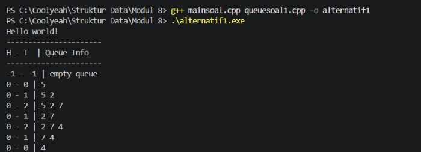
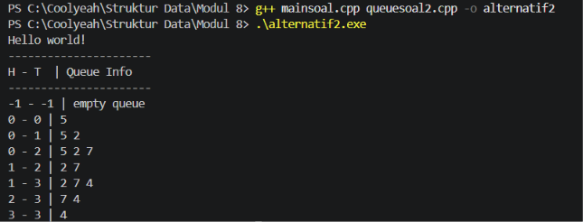
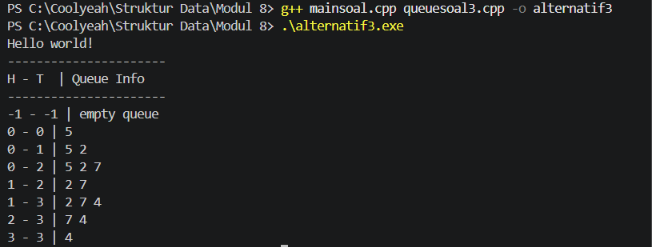

# <h1 align="center">Laporan Praktikum Modul 8 - Implementasi Queue Berbasis Array
<p align="center">Assyifa Zahra - 109082500196 

## Dasar teori
Queue (antrean) adalah struktur data linear berbasis prinsip FIFO (First In, First Out), di mana elemen yang pertama masuk akan menjadi elemen yang pertama keluar dengan operasi dasar penambahan di belakang (enqueue) serta penghapusan atau pengambilan di depan (dequeue) (Cormen et al., 2022; Goodrich et al., 2014; Malik, 2018). Dalam representasi array berkapasitas tetap pada C++, pengaturan indeks head dan tail menentukan efisiensi penggunaan ruang memori dan kebutuhan pergeseran elemen: pendekatan pertama mempertahankan head di indeks 0 sambil menggeser elemen ke kiri saat dequeue, sedangkan pendekatan kedua memajukan head dan tail tanpa menggeser elemen saat dequeue dan baru menggeser blok saat penuh semu ketika enqueue (Shaffer, 2013; Goodrich et al., 2014).

Sementara itu, pendekatan ketiga (circular queue) memanfaatkan aritmetika modulo terhadap kapasitas array agar head dan tail dapat bergerak melingkar ketika mencapai batas indeks akhir (Cormen et al., 2022; Goodrich et al., 2014). Dengan mekanisme melingkar tersebut, slot kosong di awal array akibat dequeue dapat langsung digunakan kembali pada enqueue berikutnya tanpa pergeseran elemen, selama antrean belum benar-benar penuh (Cormen et al., 2022; Malik, 2018; Shaffer, 2013).

# Guided 1
### queue.cpp
```
#include "queue.h"

boolean isEmpty(queue Q) {
    return (Q.head == Nil && Q.tail == Nil);
}

void CreateQueue(queue &Q) {
    Q.head = Nil;
    Q.tail = Nil;
}

address alokasi(infotype X) {
    address P = new elmQ;
    if (P != Nil) {
        P->info = X;
        P->next = Nil;
    }
    return P;
}

void dealokasi(address P) {
    delete P;
}

address findElm(queue Q, infotype X) {
    address P = Q.head;
    while (P != Nil) {
        if (P->info == X) {
            return P;
        }
        P = P->next;
    }
    return Nil;
}

boolean fFindElm(queue Q, address P) {
    address curr = Q.head;
    while (curr != Nil) {
        if (curr == P) {
            return true;
        }
        curr = curr->next;
    }
    return false;
}

void insert(queue &Q, address P) {
    if (P != Nil) {
        if (isEmpty(Q)) {
            Q.head = P;
            Q.tail = P;
        } else {
            Q.tail->next = P;
            Q.tail = P;
        }
    }
}

void deleteQueue(queue &Q, address &P) {
    if (!isEmpty(Q)) {
        P = Q.head;
        if (Q.head == Q.tail) {
            Q.head = Nil;
            Q.tail = Nil;
        } else {
            Q.head = P->next;
            P->next = Nil;
        }
    } else {
        P = Nil;
    }
}

void printInfo(queue Q) {
    if (isEmpty(Q)) {
        cout << "Queue kosong" << endl;
    } else {
        address P = Q.head;
        while (P != Nil) {
            cout << P->info << " ";
            P = P->next;
        }
        cout << endl;
    }
}

int nbList(queue Q) {
    int count = 0;
    address P = Q.head;
    while (P != Nil) {
        count++;
        P = P->next;
    }
    return count;
}

void delAll(queue &Q) {
    address P;
    while (!isEmpty(Q)) {
        deleteQueue(Q, P);
        dealokasi(P);
    }
}
```
Queue bekerja dengan prinsip FIFO (*First In, First Out*), di mana elemen pertama yang masuk akan keluar lebih dulu melalui `head` sementara elemen baru ditambahkan di `tail`. Pada versi *pointer* (`elmQ` dan `queue`), elemen terhubung lewat *next* dengan ukuran dinamis dan mengosongkan `head` serta `tail` ke `Nil` jika elemen terakhir dihapus, sedangkan pada versi *array* (`info[5]`) indeks `head` dan `tail` diatur lewat tiga cara: Alternatif 1 menjaga `head` tetap di awal lalu menggeser elemen saat menghapus, Alternatif 2 memajukan `head` saat menghapus dan menggeser elemen ke depan hanya saat `tail` mentok di akhir sementara masih ada ruang kosong di kiri, dan Alternatif 3 membuat `head` serta `tail` berputar memakai modulo kapasitas agar ruang kosong bisa dipakai ulang tanpa pergeseran.

### queue.h
```
#ifndef QUEUE_H_INCLUDE
#define QUEUE_H_INCLUDE

#include <iostream>
using namespace std;

#define Nil NULL

typedef bool boolean;
typedef int infotype;
typedef struct elmQ *address;

struct elmQ {
    infotype info;
    address next;
};

struct queue {
    address head, tail;
};

boolean isEmpty(queue Q);
void CreateQueue(queue &Q);
address alokasi(infotype X);
void dealokasi(address P);
address findElm(queue Q, infotype X);
boolean fFindElm(queue Q, address P);
void insert(queue &Q, address P);
void deleteQueue(queue &Q, address &P);
void printInfo(queue Q);
int nbList(queue Q);
void delAll(queue &Q);

#endif
```
File `queue.h` ini mendefinisikan struktur dan antarmuka *queue* berbasis *pointer* dengan `Nil` bernilai `NULL`, `boolean` sebagai alias `bool`, `infotype` bertipe `int`, serta *pointer* `address` yang menunjuk ke simpul `elmQ` berisi data `info` dan tautan `next` ke elemen berikutnya. Struktur `queue` sendiri menyimpan dua *pointer* utama, yaitu `head` dan `tail`, untuk menandai elemen terdepan serta terbelakang antrean, sementara daftar *prototype* fungsinya mengatur pengecekan kosong (`isEmpty`), inisialisasi (`CreateQueue`), alokasi dan dealokasi memori (`alokasi`, `dealokasi`), pencarian berdasarkan nilai atau alamat (`findElm`, `fFindElm`), penambahan serta penghapusan elemen (`insert`, `deleteQueue`), pencetakan isi (`printInfo`), penghitungan jumlah elemen (`nbList`), dan pembersihan seluruh antrean (`delAll`).

### main.cpp
```
#include <iostream>
#include "queue.h"
using namespace std;

int main() {
    queue Q;
    address P;

    CreateQueue(Q);
    cout << "isEmpty: " << isEmpty(Q) << endl;
    printInfo(Q);

    insert(Q, alokasi(5));
    insert(Q, alokasi(2));
    insert(Q, alokasi(7));
    cout << "Setelah insert 5, 2, 7" << endl;
    printInfo(Q);
    cout << "nbList : " << nbList(Q) << endl;

    P = findElm(Q, 2);
    if (P != Nil) {
        cout << "findElm(2) ketemu, info = " << P->info << endl;
        cout << "fFindElm : " << fFindElm(Q, P) << endl;
    }
    if (findElm(Q, 9) == Nil) {
        cout << "findElm(9) tidak ketemu" << endl;
    }

    deleteQueue(Q, P);
    cout << "Setelah delete, elemen yang keluar = " << P->info << endl;
    dealokasi(P);
    printInfo(Q);

    delAll(Q);
    cout << "Setelah delAll" << endl;
    printInfo(Q);
    cout << "isEmpty: " << isEmpty(Q) << endl;

    return 0;
}
```
File `main.cpp` ini menguji seluruh primitif *queue* berbasis *pointer* mulai dari inisialisasi antrean kosong lewat `CreateQueue` dan pengecekan `isEmpty`, lalu menyisipkan nilai `5`, `2`, dan `7` ke bagian belakang antrean dengan `insert` dan `alokasi` serta menampilkan isi dan jumlahnya memakai `printInfo` dan `nbList`. Selanjutnya program menguji pencarian nilai ada (`2`) dan tidak ada (`9`) lewat `findElm` serta pengecekan keberadaan alamat simpul lewat `fFindElm`, mengeluarkan elemen terdepan (`5`) sesuai urutan FIFO dengan `deleteQueue` lalu membebaskan memorinya lewat `dealokasi`, dan menutup pengujian dengan mengosongkan seluruh sisa antrean menggunakan `delAll` sebelum memeriksa kembali status kosongnya.

<br>

# Guided 2
### queue2.cpp
```
#include "queue.h"
#include <iostream>

using namespace std;

// NOTE : 
// Implementasi 1 = head diam, tail bergerak (Queue Linear Statis, kerana head nya tetap diam)
// Implementasi 2 = head bergerak, tail bergerak (Queue Linear Dinamis, karena head & tail nya sama-sama bergerak)
// Implementasi 3 = head dan tail berputar (Queue Circular, karena jika udh mentok tapi masih ada space, diputar sehingga tail bisa ada didepan head)

bool isEmpty(queue Q){
    if(Q.head == -1 && Q.tail == -1){
        return true;
    } else {
        return false;
    }
}

//isFull implmenetasi 1 & 2
bool isFull(queue Q){
    if(Q.tail == MAKSIMAL - 1){
        return true;
    } else {
        return false;
    }
}

// //isFull implementasi 3
// bool isFull(queue Q){
//     if((Q.tail + 1) % MAKSIMAL == Q.head){
//         return true;
//     } else {
//         return false;
//     }
// }

void CreateQueue(queue &Q){ //terbentuk queue dengan head = -1 dan tail = -1 
    Q.head = -1;
    Q.tail = -1;
}
 

//enqueue implementasi 1 & 2
void enQueue(queue &Q, string nama){
    if(isFull(Q) == true){
        cout << "Queue sudah penuh!" << endl;
    } else {
        if(isEmpty(Q) == true){
            Q.head = Q.tail = 0;
        } else {
            Q.tail++;
        }
        Q.nama[Q.tail] = nama;
        cout << "nama " << nama << " berhasil ditambahkan kedalam queue!" << endl;
    }
}

// //enQueue implementasi 3
// void enQueue(queue &Q, string nama){
//     if(isFull(Q) == true){
//         cout << "Queue sudah penuh!" << endl;
//     } else {
//         if(isEmpty(Q) == true){
//             Q.head = Q.tail = 0;
//         } else {
//             Q.tail = (Q.tail + 1) % MAKSIMAL; // bergerak melingkar
//         }
//         Q.nama[Q.tail] = nama;
//         cout << "nama " << nama << " berhasil ditambahkan kedalam queue!" << endl;
//     }
// }

//dequeue implementasi 1
void deQueue(queue &Q){
    if(isEmpty(Q) == true){
        cout << "Queue kosong!" << endl;
    } else {
        cout << "Mengahapus data " << Q.nama[Q.head] << "..." << endl;
        for(int i = 0; i < Q.tail; i++){
            Q.nama[i] =  Q.nama[i+1];
        }
        Q.tail--;
        if(Q.tail < 0){ //kalo semua isi queue nya udh dikelaurin, set head & tail ke -1
            Q.head = -1;
            Q.tail = -1;
        }
    }
}

// //dequeue implementasi 2
// void deQueue(queue &Q){
//     if(isEmpty(Q) == true){
//         cout << "Queue kosong!" << endl;
//     } else {
//         cout << "Mengahapus data " << Q.nama[Q.head] << "..." << endl;
//         Q.head++;
//         if(Q.head > Q.tail){ //kalo elemennya udh abis (head akan lebih 1 dari tail), maka reset ulang head & tail ke -1
//             Q.head = -1;
//             Q.tail = -1;
//         }
//     }
// }

// //deQueue implementasi 3
// void deQueue(queue &Q){
//     if(isEmpty(Q) == true){
//         cout << "Queue kosong!" << endl;
//     } else {
//         cout << "Mengahapus data " << Q.nama[Q.head] << "..." << endl;
//         if(Q.head == Q.tail){ //kalo elemennya tinggal 1, langsungkan saja head & tail nya reset ke -1
//             Q.head = -1;
//             Q.tail = -1;
//         } else {
//             Q.head = (Q.head + 1) % MAKSIMAL; // bergerak melingkar
//         }
//     }
// }

//viewQueue implementasi 1 & 2
void viewQueue(queue Q){
    if(isEmpty(Q) == true){
        cout << "Queue kosong!" << endl;
    } else {
        for(int i = Q.head; i <= Q.tail; i++){
            cout << i -  Q.head + 1 << ". " << Q.nama[i] << endl;
        }
    }
    cout << endl;
}

// //viewQueue implementasi 3
// void viewQueue(queue Q){
//     if(isEmpty(Q) == true){
//         cout << "Queue kosong!" << endl;
//     } else {
//         int i = Q.head;
//         int count = 1;
//         while(true){
//             cout << count << ". " << Q.nama[i] << endl;
//             if(i == Q.tail){
//                 break;
//             }
//             i = (i + 1) % MAKSIMAL;
//             count++;
//         }   
//     }
// }
```
Kode ini menyusun primitif *queue* berbasis *array* (`Q.nama` berkapasitas `MAKSIMAL`) dengan `CreateQueue` mengatur `head` dan `tail` ke `-1` saat kosong serta `isEmpty` memeriksa kondisi tersebut, lalu menyediakan tiga varian mekanisme antrean yang dapat diaktifkan sesuai kebutuhan. Pada implementasi pertama (`head` diam di awal dan `tail` bergerak), `enQueue` menambah data dengan memajukan `tail` selama `tail` belum mencapai `MAKSIMAL - 1` (`isFull`), sedangkan `deQueue` menggeser sisa elemen ke kiri lalu menurunkan `tail` atau me-reset keduanya ke `-1` bila antrean habis. Pada implementasi kedua (`head` dan `tail` sama-sama bergerak), `deQueue` cukup memajukan `head` tanpa menggeser elemen dan me-reset `head` serta `tail` ke `-1` jika `head` melewati `tail`. Sementara itu, pada implementasi ketiga (*circular queue*), `enQueue` dan `deQueue` menggerakkan `tail` serta `head` secara melingkar dengan modulo `MAKSIMAL` dan `isFull` mengecek `((Q.tail + 1) % MAKSIMAL == Q.head)`, sedangkan `viewQueue` menampilkan urutan elemen baik secara beruntun (`Q.head` sampai `Q.tail`) maupun melingkar hingga menyentuh `Q.tail`.

### queue2.h
```
#ifndef QUEUE_H
#define QUEUE_H

#include <iostream>
using namespace std;

const int MAKSIMAL = 5;

struct queue {
    string nama[MAKSIMAL];
    int head;
    int tail;
};

bool isFull(queue Q);
bool isEmpty(queue Q);
void CreateQueue(queue &Q);
void enQueue(queue &Q, string nama);
void deQueue(queue &Q);
void viewQueue(queue Q);

#endif
```
File `queue.h` ini mendefinisikan struktur antrean berbasis *array* berukuran tetap `MAKSIMAL = 5` yang menyimpan data `string nama[MAKSIMAL]` beserta penanda indeks `head` dan `tail` bertipe `int`. Selain itu, file ini memuat *prototype* fungsi utama antrean untuk mengecek status penuh dan kosong (`isFull`, `isEmpty`), menginisialisasi antrean (`CreateQueue`), menambah dan menghapus elemen (`enQueue`, `deQueue`), serta menampilkan isi antrean (`viewQueue`).

### main.cpp
```
#include "queue.h"
#include <iostream>

using namespace std;

int main(){
    queue Q;

    CreateQueue(Q);
    enQueue(Q, "Dimas");
    enQueue(Q, "Arvin");
    enQueue(Q, "Rizal");
    enQueue(Q, "Hafizh");
    enQueue(Q, "Fathur");
    enQueue(Q, "Daffa");
    cout << endl;

    cout << "--- Isi Queue Setelah enQueue ---" << endl;
    viewQueue(Q);
    cout << endl;

    deQueue(Q);
    deQueue(Q);
    deQueue(Q);
    deQueue(Q);
    // deQueue(Q);
    // deQueue(Q);
    cout << endl;

    cout << "--- Isi Queue Setelah deQueue ---" << endl;
    viewQueue(Q);

    return 0;
}
```
File `main.cpp` ini menjalankan skenario uji coba antrean bertipe `string` dengan menginisialisasi `Q` lewat `CreateQueue`, lalu memasukkan enam nama (`Dimas`, `Arvin`, `Rizal`, `Hafizh`, `Fathur`, dan `Daffa`) menggunakan `enQueue` sehingga elemen keenam (`Daffa`) akan ditolak apabila kapasitas `MAKSIMAL = 5` sudah penuh. Setelah menampilkan daftar isi antrean melalui `viewQueue`, program memanggil `deQueue` sebanyak empat kali untuk mengeluarkan elemen terdepan secara berurutan sesuai prinsip FIFO (`Dimas`, `Arvin`, `Rizal`, dan `Hafizh`) sambil membiarkan dua panggilan `deQueue` berikutnya tetap dikomentari, lalu kembali mencetak sisa isi antrean (`Fathur`) dengan `viewQueue`.

---

# Unguided
##### 1. Buatlah ADT Queue menggunakan ARRAY sebagai berikut di dalam file “queue.h”: 
```
Type infotype: integer 
Type Queue:  < 
    info : array [5] of infotype {index array dalam C++ 
    dimulai dari 0} 
    head, tail : integer 
> 
procedure CreateQueue (input/output Q: Queue) 
function isEmptyQueue (Q: Queue) → boolean 
function isFullQueue (Q: Queue) → boolean 
procedure enqueue (input/output Q: Queue, input x: infotype)  
function dequeue (input/output Q: Queue) → infotype 
procedure printInfo (input Q: Queue) 
```
##### Buatlah implementasi ADT Queue pada file “queue.cpp” dengan menerapkan mekanisme queue  Alternatif 1 (head diam, tail bergerak). 
```
int main() { 
    cout << "Hello World" << endl; 
    Queue Q; 
    createQueue(Q); 

    cout<<"----------------------"<<endl; 
    cout<<" H - T \t | Queue info"<<endl; 
    cout<<"----------------------"<<endl; 
    printInfo(Q); 
    enqueue(Q,5); printInfo(Q); 
    enqueue(Q,2); printInfo(Q); 
    enqueue(Q,7); printInfo(Q); 
    dequeue(Q); printInfo(Q); 
    enqueue(Q,4); printInfo(Q); 
    dequeue(Q); printInfo(Q); 
    dequeue(Q); printInfo(Q); 

    return 0;
}
```
##### 2. Buatlah implementasi ADT Queue pada file “queue.cpp” dengan menerapkan mekanisme queue  Alternatif 2 (head bergerak, tail bergerak). 
##### 3. Buatlah implementasi ADT Queue pada file “queue.cpp” dengan menerapkan mekanisme queue  Alternatif 3 (head dan tail berputar).

### queue.h
```
#ifndef QUEUE_H
#define QUEUE_H

#include <iostream>
using namespace std;

typedef int infotype;

struct Queue {
    infotype info[5]; // indeks 0 s.d. 4 (kapasitas maksimal 5 elemen)
    int head;
    int tail;
};

void createQueue(Queue &Q);
bool isEmptyQueue(Queue Q);
bool isFullQueue(Queue Q);
void enqueue(Queue &Q, infotype x);
infotype dequeue(Queue &Q);
void printInfo(Queue Q);

#endif
```
File `queue.h` ini mendefinisikan struktur antrean bertipe `int` (`infotype`) dengan *array* tetap `info[5]` berkapasitas lima elemen (indeks `0` sampai `4`) beserta penanda posisi `head` dan `tail` bertipe `int`. Selain itu, file ini menyediakan deklarasi fungsi utama *queue* untuk membuat antrean (`createQueue`), memeriksa status kosong dan penuh (`isEmptyQueue`, `isFullQueue`), menambah serta mengambil elemen (`enqueue`, `dequeue`), dan menampilkan isi beserta posisi indeks antrean (`printInfo`).

### queue1.cpp (Alternatif 1)
```
#include "queue.h"

void createQueue(Queue &Q) { Q.head = -1; Q.tail = -1; }
bool isEmptyQueue(Queue Q) { return Q.head == -1 && Q.tail == -1; }
bool isFullQueue(Queue Q) { return Q.head == 0 && Q.tail == 4; }

void enqueue(Queue &Q, infotype x) {
    if (isFullQueue(Q)) { cout << "Queue penuh" << endl; return; }
    if (isEmptyQueue(Q)) Q.head = Q.tail = 0;
    else Q.tail++;
    Q.info[Q.tail] = x;
}

infotype dequeue(Queue &Q) {
    if (isEmptyQueue(Q)) { cout << "Queue kosong" << endl; return -1; }
    infotype x = Q.info[Q.head];
    if (Q.head == Q.tail) createQueue(Q);
    else {
        for (int i = Q.head; i < Q.tail; i++) Q.info[i] = Q.info[i + 1];
        Q.tail--;
    }
    return x;
}

void printInfo(Queue Q) {
    cout << Q.head << " - " << Q.tail << " | ";
    if (isEmptyQueue(Q)) { cout << "empty queue" << endl; return; }
    for (int i = Q.head; i <= Q.tail; i++) cout << Q.info[i] << (i < Q.tail ? " " : "");
    cout << endl;
}
```
Kode `queue.cpp` ini mengimplementasikan *queue* berbasis *array* Alternatif 1 (`head` tetap di indeks `0`, `tail` bergerak), dengan `createQueue` menginisialisasi `head` dan `tail` ke `-1`, `isEmptyQueue` mengecek apakah keduanya `-1`, serta `isFullQueue` memeriksa apakah `head` di `0` dan `tail` sudah mencapai indeks `4`. Saat `enqueue` dijalankan, data baru `x` ditambahkan dengan menggeser `tail` ke posisi berikutnya (atau mengeset `head` dan `tail` ke `0` jika antrean masih kosong) selama belum penuh, sedangkan `dequeue` mengambil elemen terdepan (`Q.info[Q.head]`), lalu me-reset antrean jika hanya tersisa satu elemen atau menggeser seluruh elemen setelahnya ke kiri dan mengurangi `tail` agar elemen pertama tetap berada di indeks `0`. Terakhir, `printInfo` menampilkan posisi indeks `head` dan `tail` diikuti tulisan `empty queue` jika kosong atau deretan isi elemen dari `head` sampai `tail`.

### queue2.cpp (Alternatif 2)
```
#include "queue.h"

void createQueue(Queue &Q) { Q.head = -1; Q.tail = -1; }
bool isEmptyQueue(Queue Q) { return Q.head == -1 && Q.tail == -1; }
bool isFullQueue(Queue Q) { return Q.head == 0 && Q.tail == 4; }

void enqueue(Queue &Q, infotype x) {
    if (isFullQueue(Q)) { cout << "Queue penuh" << endl; return; }
    if (isEmptyQueue(Q)) Q.head = Q.tail = 0;
    else {
        if (Q.tail == 4 && Q.head > 0) {
            int shift = Q.head;
            for (int i = Q.head; i <= Q.tail; i++) Q.info[i - shift] = Q.info[i];
            Q.head = 0;
            Q.tail -= shift;
        }
        Q.tail++;
    }
    Q.info[Q.tail] = x;
}

infotype dequeue(Queue &Q) {
    if (isEmptyQueue(Q)) { cout << "Queue kosong" << endl; return -1; }
    infotype x = Q.info[Q.head];
    if (Q.head == Q.tail) createQueue(Q);
    else Q.head++;
    return x;
}

void printInfo(Queue Q) {
    cout << Q.head << " - " << Q.tail << " | ";
    if (isEmptyQueue(Q)) { cout << "empty queue" << endl; return; }
    for (int i = Q.head; i <= Q.tail; i++) cout << Q.info[i] << (i < Q.tail ? " " : "");
    cout << endl;
}
```
Kode `queue.cpp` ini mengimplementasikan *queue* berbasis *array* Alternatif 2 (`head` dan `tail` sama-sama bergerak), dengan `createQueue` mengeset `head` dan `tail` ke `-1`, `isEmptyQueue` memeriksa apakah keduanya `-1`, serta `isFullQueue` memeriksa apakah antrean sudah penuh dari indeks `0` sampai `4`. Saat `enqueue` dijalankan, elemen baru disisipkan setelah `tail` maju (atau diset ke `0` jika antrean kosong), dan jika `tail` sudah mencapai indeks `4` padahal `head > 0` (kondisi penuh semu), elemen yang tersisa digeser ke depan lalu `head` dan `tail` disesuaikan agar ruang kosong di belakang bisa dipakai kembali. Sementara itu, `dequeue` mengambil elemen di `Q.head` lalu langsung memajukan `head` tanpa menggeser elemen (atau me-reset antrean jika hanya tersisa satu elemen), dan `printInfo` menampilkan posisi `head - tail` beserta isi elemen dari `head` sampai `tail` atau `empty queue` jika kosong.

### queue3.cpp (Alternatif 3)
```
#include "queue.h"

void createQueue(Queue &Q) { Q.head = -1; Q.tail = -1; }
bool isEmptyQueue(Queue Q) { return Q.head == -1 && Q.tail == -1; }
bool isFullQueue(Queue Q) { return !isEmptyQueue(Q) && ((Q.tail + 1) % 5 == Q.head); }

void enqueue(Queue &Q, infotype x) {
    if (isFullQueue(Q)) { cout << "Queue penuh" << endl; return; }
    if (isEmptyQueue(Q)) Q.head = Q.tail = 0;
    else Q.tail = (Q.tail + 1) % 5;
    Q.info[Q.tail] = x;
}

infotype dequeue(Queue &Q) {
    if (isEmptyQueue(Q)) { cout << "Queue kosong" << endl; return -1; }
    infotype x = Q.info[Q.head];
    if (Q.head == Q.tail) createQueue(Q);
    else Q.head = (Q.head + 1) % 5;
    return x;
}

void printInfo(Queue Q) {
    cout << Q.head << " - " << Q.tail << " | ";
    if (isEmptyQueue(Q)) { cout << "empty queue" << endl; return; }
    int i = Q.head;
    while (true) {
        cout << Q.info[i];
        if (i == Q.tail) break;
        cout << " ";
        i = (i + 1) % 5;
    }
    cout << endl;
}
```
Kode `queue.cpp` ini mengimplementasikan *queue* berbasis *array* Alternatif 3 (*circular queue*, di mana `head` dan `tail` bergerak melingkar), dengan `createQueue` mengeset `head` dan `tail` ke `-1` saat kosong, `isEmptyQueue` mengecek apakah keduanya `-1`, serta `isFullQueue` memeriksa apakah posisi berikutnya dari `tail` (`(Q.tail + 1) % 5`) bertemu dengan `head` saat antrean tidak kosong. Saat `enqueue` dijalankan, elemen baru disisipkan pada indeks `0` jika antrean kosong atau pada `(Q.tail + 1) % 5` agar `tail` berputar kembali ke awal *array* jika sudah melewati batas akhir tanpa perlu menggeser elemen. Sementara itu, `dequeue` mengambil elemen di `Q.head` lalu me-reset antrean bila hanya tersisa satu elemen atau memajukan `head` secara melingkar dengan `(Q.head + 1) % 5`, dan `printInfo` mencetak posisi `head - tail` beserta urutan isi elemen dari `head` sampai `tail` secara melingkar atau `empty queue` jika kosong.

### main.cpp
```
#include "queue.h"
#include <iostream>
using namespace std;

int main() {
    cout << "Hello world!" << endl;
    Queue Q;
    createQueue(Q);

    cout << "----------------------" << endl;
    cout << "H - T  | Queue Info" << endl;
    cout << "----------------------" << endl;

    printInfo(Q);
    enqueue(Q, 5);
    printInfo(Q);
    enqueue(Q, 2);
    printInfo(Q);
    enqueue(Q, 7);
    printInfo(Q);
    dequeue(Q);
    printInfo(Q);
    enqueue(Q, 4);
    printInfo(Q);
    dequeue(Q);
    printInfo(Q);
    dequeue(Q);
    printInfo(Q);

    return 0;
}
```
File `main.cpp` ini menguji kerja *queue* berbasis *array* dengan menampilkan *header* tabel `H - T  | Queue Info`, menginisialisasi `Q` menjadi kosong lewat `createQueue`, lalu menjalankan urutan operasi `enqueue` dan `dequeue` (`5`, masuk `2`, masuk `7`, keluar `5`, masuk `4`, keluar `2`, lalu keluar `7`) sambil mencetak kondisi indeks `head - tail` dan isi antrean setelah tiap langkah melalui `printInfo` agar alur FIFO dan perubahan posisinya terlihat jelas.

## Output

### Output Alternatif 1


### Output Alternatif 2


### Output Alternatif 3


Ketiga hasil eksekusi tersebut berhasil di-compile dan dijalankan tanpa error. Pada ketiganya, urutan isi antrean selalu mengikuti prinsip FIFO (*First In, First Out*): masuk `5`, `2`, `7`, keluar `5` (tersisa `2 7`), masuk `4` (menjadi `2 7 4`), keluar `2` (tersisa `7 4`), lalu keluar `7` (tersisa `4`). Perbedaan ketiganya tampak jelas pada nilai indeks **`H - T`** (`head - tail`) setelah operasi `dequeue` dan `enqueue`:

### 1. Alternatif 1 (`queuesoal1.cpp` — `head` tetap di `0`, `tail` bergerak)

* Saat `5` dikeluarkan (`dequeue`), indeks `H` tetap di `0`, tetapi sisa elemen `2 7` digeser ke kiri sehingga `T` turun menjadi `1` (`0 - 1 | 2 7`).


* Saat `4` masuk (`enqueue`), `T` naik ke `2` (`0 - 2 | 2 7 4`).


* Setelah dua kali `dequeue` berikutnya (`2` lalu `7` keluar), sisa `4` digeser ke indeks `0` sehingga posisinya menjadi `0 - 0 | 4`.


### 2. Alternatif 2 (`queuesoal2.cpp` — `head` bergerak, `tail` bergerak)

* Saat `5` dikeluarkan (`dequeue`), elemen tidak digeser ke kiri; `H` maju dari `0` ke `1` sehingga indeksnya menjadi `1 - 2 | 2 7`.


* Saat `4` masuk (`enqueue`), `T` maju dari `2` ke `3` sehingga indeksnya menjadi `1 - 3 | 2 7 4`.


* Setelah `2` dan `7` dikeluarkan satu per satu, `H` ikut maju (`2 - 3 | 7 4` lalu `3 - 3 | 4`) sampai menyamai `T` di indeks `3`.


### 3. Alternatif 3 (`queuesoal3.cpp` — *circular queue*, `head` dan `tail` bergerak melingkar)

* Pada skenario uji coba yang pendek ini (`head` dan `tail` masih di indeks `0`–`3`), pergerakan indeks `H - T` terlihat sama seperti Alternatif 2 (`-1 - -1`, `0 - 0`, `0 - 1`, `0 - 2`, `1 - 2`, `1 - 3`, `2 - 3`, `3 - 3`) karena belum melewati batas akhir indeks `4` untuk berputar (`% 5`).


* Bedanya, pada Alternatif 3 jika antrean terus bertambah melewati indeks `4`, `tail` akan berputar kembali ke indeks `0` (selama slot tersebut kosong) tanpa perlu menggeser elemen seperti Alternatif 1 maupun menggeser blok seperti Alternatif 2.

## Kesimpulan
Berdasarkan praktikum implementasi *queue* berbasis *array* pada ketiga alternatif (`queuesoal1.cpp`, `queuesoal2.cpp`, dan `queuesoal3.cpp`), seluruh program berhasil dijalankan dan mempertahankan prinsip FIFO (*First In, First Out*) dengan urutan data yang konsisten pada skenario uji coba yang sama. Perbedaan utama ketiganya terletak pada mekanisme pergerakan indeks `head` (`H`) dan `tail` (`T`): Alternatif 1 menjaga `head` tetap di indeks `0` dengan menggeser elemen ke kiri setiap `dequeue`, Alternatif 2 memajukan `head` dan `tail` tanpa menggeser elemen saat `dequeue` (dengan pergeseran dilakukan hanya saat penuh semu ketika `enqueue`), sedangkan Alternatif 3 menggunakan aritmetika modulo agar `head` dan `tail` dapat bergerak melingkar memanfaatkan ruang *array* secara efisien.

## Referensi
1. Cormen, T. H., Leiserson, C. E., Rivest, R. L., & Stein, C. (2022). Introduction to Algorithms (4th ed.). MIT Press.

2. Goodrich, M. T., Tamassia, R., & Goldwasser, M. H. (2014). Data Structures and Algorithms in C++ (2nd ed.). John Wiley & Sons.

3. Malik, D. S. (2018). C++ Programming: From Problem Analysis to Program Design (8th ed.). Cengage Learning.

4. Shaffer, C. A. (2013). A Practical Introduction to Data Structures and Algorithm Analysis (3rd ed.). Pearson.
